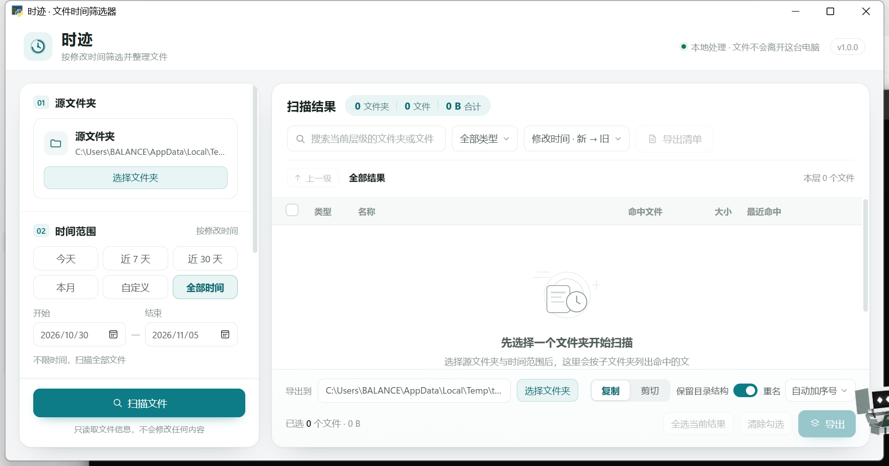

# 时迹 · 文件时间筛选器

按「修改时间」扫描文件夹，以**子文件夹目录**的形式浏览命中文件，再复制 / 剪切到导出目录。



## 运行方式

### 方式 A：直接双击 exe（推荐，免安装）

打包产物：`dist\时迹.exe`

- 单个文件，无需安装 Python / Node。
- 优先使用 **Microsoft Edge WebView2 Runtime**（Windows 11 自带；Windows 10 装了新版 Edge 一般也有）。
- 若检测不到 WebView2（或初始化失败/超时/被杀软拦截），程序**不会变成砖**：自动在本机 `127.0.0.1` 起服务，并用系统默认浏览器打开同一套界面，功能照常可用；页面顶部横幅会说明原因并提供下载地址。
- 首次启动会解压到临时目录，实测冷启动约 **2.2–2.4 秒**；之后启动更快。
- 程序**不写任何日志文件**：正常运行完全静默；启动失败或未捕获异常会弹出一个简短的系统提示框说明原因。

### 方式 B：源码运行

```bat
python -m pip install -r requirements.txt
python main.py
```

要求 Python 3.10+（开发机使用 Python 3.14）。

### 没有 WebView2 时的浏览器模式

启动时会先检测运行时：注册表 `HKLM\SOFTWARE\WOW6432Node\Microsoft\EdgeUpdate\Clients\{F3017226-FE2A-4295-8BDF-00C3A9A7E4C5}` / `HKCU` 对应项、版本目录里的 `msedgewebview2.exe`，以及打包内的 `WebView2Loader.dll`。检测结果分为：**运行时缺失 / 安装残缺 / 初始化失败 / 启动超时 / 疑似被安全软件拦截**。

不可用时自动进入浏览器降级：

- 后端只监听本机 `127.0.0.1` 随机端口，**自动用系统默认浏览器打开界面**；每次启动生成一次性随机 token 放在 URL 路径中，并校验 `Host`/`Origin`，本机其它网页无法盲调接口。关掉页面后约 2 分钟无心跳自动退出；若仍有扫描/导出在执行，会等任务收尾后再退出。
- 页面顶部横幅显示原因与下载地址 `https://go.microsoft.com/fwlink/p/?LinkId=2124703`；安装 WebView2 后重新打开即为原生窗口。
- 降级限制：文件夹选择改为弹窗**手动输入绝对路径**（浏览器无法调用系统文件夹选择器），输入后会校验路径是否存在；不支持拖拽文件夹；其余扫描、筛选、导出功能不变。
- 再次双击 exe 会复用地址文件重新打开浏览器里的已有页面（单实例仍生效，陈旧/无 token 地址会被丢弃）。

## 打包

双击 `build.bat`，脚本会自动安装依赖 + PyInstaller，并生成：

```
dist\时迹.exe
```

打包前脚本会把旧 exe 备份到 `dist_backup\`，再清理 `build\`、`dist\`，不会删掉唯一产物。

等价命令：

```bat
python -m PyInstaller --noconfirm --clean --onefile --windowed ^
  --name "时迹" --icon "assets\app.ico" ^
  --add-data "web;web" --add-data "assets\app.ico;assets" ^
  --exclude-module PyQt5 --exclude-module PyQt6 ^
  --exclude-module PySide2 --exclude-module PySide6 ^
  --exclude-module matplotlib --exclude-module numpy --exclude-module pandas ^
  --exclude-module PIL --exclude-module IPython --exclude-module jupyter ^
  main.py
```

产物约 **17 MB**（排除无关依赖前为 46–48 MB）。

## 功能

- 源文件夹选择，支持把文件夹直接拖进窗口。
- 时间范围：今天 / 近 7 天 / 近 30 天 / 本月 / 全部时间 / 自定义。
- 扫描条件：子文件夹递归开关、扩展名过滤、文件名关键字过滤。
- 结果以**子文件夹为单位**展示：文件夹名、命中文件数、合计大小、最近命中时间；只显示有命中的文件夹。
- 点击文件夹逐层下钻，带面包屑与「上一级」；文件夹内无命中时显示空状态。
- 文件夹与文件均可勾选，勾选文件夹 = 选中其下全部命中文件；半选状态随子级联动。
- 当前层级的搜索、类型过滤、排序（时间 / 名称 / 大小）。
- 导出：复制（默认）或剪切；保留原目录结构（可关闭改为平铺）。
- 重名冲突：跳过并记录 / 自动加序号 / 覆盖。
- 导出进度、可取消；完成后汇总成功 / 跳过 / 失败数量，失败项在弹窗内列出。
- 结果区每个文件可在资源管理器中定位。
- 记住上次设置：便携模式写在 exe 同目录 `settings.json`；不可写时写 `%APPDATA%\ShiJi\settings.json`，不写注册表。
- 扫描 / 导出全部在后台线程执行，界面按 250 行分块渲染，上万文件不阻塞。

## 目录结构

```
main.py           程序入口（DPI/单实例/窗口/致命错误弹窗）
api.py            前端桥接接口（扫描/导出/设置/文件操作）
scanner.py        按修改时间扫描（跳过联接点防目录环）
exporter.py       复制/剪切 + 重名处理
job.py            后台任务状态与取消
store.py          设置持久化（便携 / %APPDATA%，原子写）
fileutil.py       路径、长路径、大小/时间格式化、资源路径
runtime_check.py  WebView2 运行时检测与启动失败分类
browser_mode.py   浏览器降级：本机回环 HTTP + JS 桥
web/              前端页面（原生 HTML/CSS/JS，无框架）
assets/app.ico    应用图标（16/24/32/48/64/128/256）
docs/icon/        图标矢量源 SVG 与 512px 预览
docs/ui-preview.png          源码模式界面截图
docs/exe-coldstart.png       打包 exe 冷启动截图
docs/browser-mode-real.png   浏览器降级模式（真实默认浏览器）
docs/AUDIT_PROGRESS.md       审计与修复进度记录
tests/test_core.py           核心逻辑测试（unittest）
tests/test_runtime_check.py  WebView2 检测/分类单元测试
tests/browser_mode_probe.py  浏览器降级 HTTP 端到端探针
tests/gui_e2e.py             真实 GUI 端到端测试
tests/coldstart_check.ps1    打包 exe 双击等价验证
build.bat         一键打包
requirements.txt  运行依赖
```

## 已验证（2026-11-05 第九轮：移除 CSV 清单与磁盘日志）

- 核心逻辑 `python -m unittest discover -s tests -v`：**55/55 通过**（core 25 项 + 浏览器安全/生命周期 19 项 + runtime 11 项）。导出相关断言改为对目标目录做**文件树快照**：复制/剪切/重名/覆盖/取消后目录里只有预期的导出文件，没有 CSV 清单或临时文件。
- 真实 GUI 端到端 `python tests/gui_e2e.py`：**18/18 通过**。真实窗口 + 中文/空格路径，扫描 6 文件 → 勾选联动/半选/下钻全选 → 全选 6 → 导出成功 6 / 失败 0；断言目标目录**恰好只有 6 个导出文件**（`extra=[]`），没有 CSV 清单。
- WebView2 检测 `python -m unittest tests.test_runtime_check -v`：**11/11 通过**（未受本轮改动影响）。
- 浏览器降级端到端：源码模式 `tests/browser_mode_probe.py` **11/11** 通过、`--quit` **8/8**、退出码 0、地址文件清理。打包 exe 强制降级执行 `--scan --export --quit`：**15/15 通过**，含"导出成功 3 个""导出目录仅含 3 个原文件（无 CSV 清单）"。
- 打包产物 `dist\时迹.exe`（17,161,984 字节，SHA256 `9B6FE336…39F477A`，PE 子系统=2 无控制台）：双击等价冷启动 **2.43s** 出现窗口、第二次 **2.30s**；标题栏命中 `nchittest=2`、大小/小图标均已设置、截图采样 636 种颜色（页面确已渲染）；第三次启动被单实例逻辑激活并自行退出；正常关闭退出码 0。
- **无日志验证方式**：冷启动脚本在启动前清理 `dist\shiji.log`、`shiji.log.1`、`%TEMP%\shiji.log`，每次启动/关闭后重新检查三处路径，三次结果均为不存在；源码降级与 exe 全流程结束后同样确认程序目录与 `%TEMP%` 均无 `shiji.log`。旧包已备份至 `dist_backup\时迹_旧包_20261105_165809.exe`。
- 窗口拖动 / 最大化 / 还原 / 150% DPI 已在以往轮次实测；本轮未重做多倍率屏幕验证（见 `docs/AUDIT_PROGRESS.md`）。

## 已知限制

- 优先使用系统的 WebView2 Runtime；缺失时自动进入浏览器模式（见上文），此时文件夹选择需手动输入路径、不支持拖拽。本机已安装 WebView2，缺失路径通过 `WEBVIEW2_FORCE_MISSING=1` 模拟验证，**尚未在真实未安装运行时的机器上实测**。
- 默认包不内置 WebView2 运行时（保持 ~17 MB）；如需完全离线免安装，可另行内置固定版本运行时（体积约 +100 MB）。
- 扫描结果在内存中保留，单次扫描上限 100,000 个文件（超出会提示已截断）。
- 剪切的跨磁盘操作由系统复制后删除，速度取决于磁盘；导出可取消，已完成的文件保留。
- 便携模式只有在 exe 所在目录可写时才会把 `settings.json` 放在 exe 旁（例如放 U 盘、桌面）；放在 `Program Files` 时会自动改用 `%APPDATA%`。
- 不支持云盘占位文件的"仅在线"内容读取；访问受限目录时会在扫描汇总里显示"无法访问的位置"数量。
- 单次运行只允许一个实例；再次双击会激活已有窗口，而不是开新窗口。
